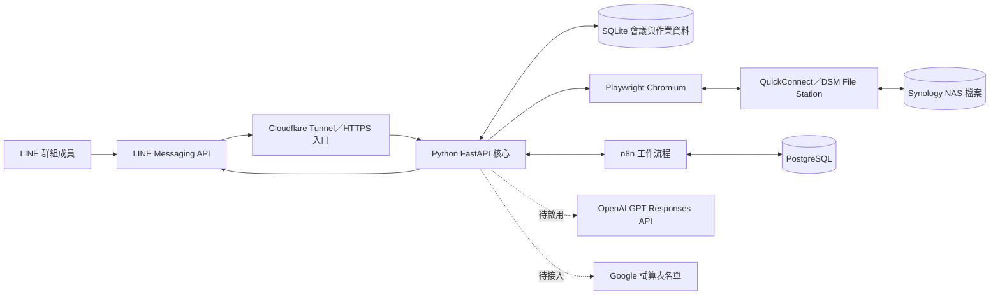
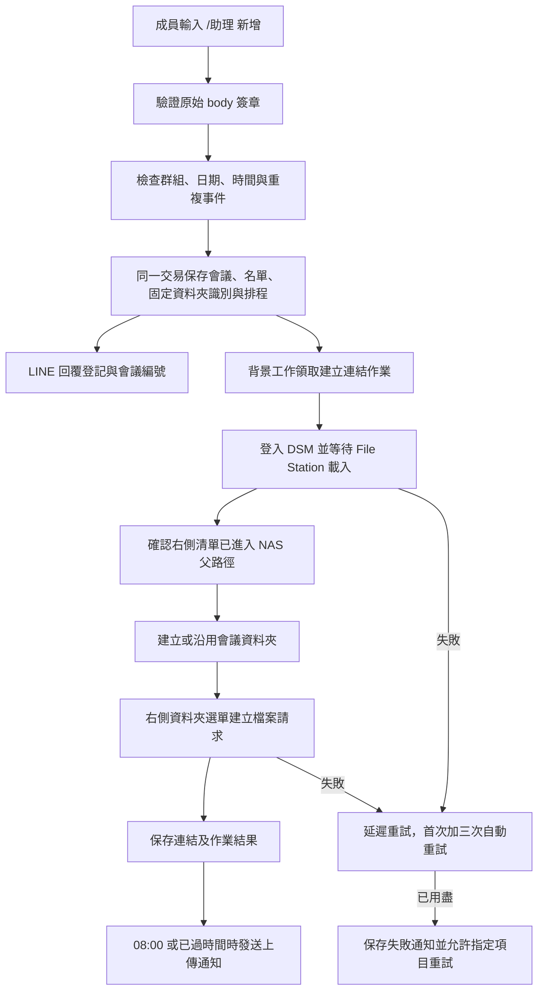
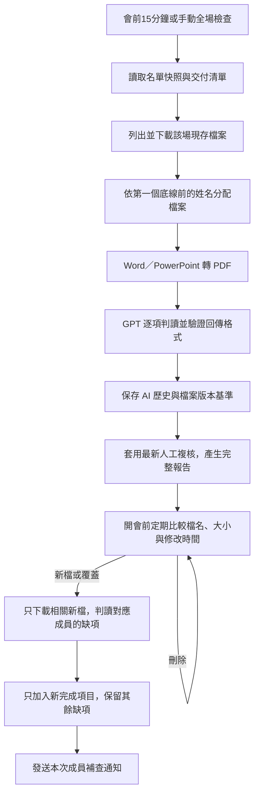

# LINE Bot 會議自動化擴充進度報告

報告日期為 2026 年 11 月 19 日，時區採 Asia/Taipei。本報告依原始碼、自動測試及實際 LINE／NAS 驗收紀錄編寫。

## 一、現階段成果與驗證範圍

| 項目 | 程式與部署狀態 | 驗證結果與限制 |
|---|---|---|
| LINE 群組入口 | 正式版已部署，原始 body 驗證簽章 | 已在群組收到查詢與建會回覆。群組必須加入部署憑證所對應的官方帳號 |
| 新增、改期、取消、今日查詢 | 已實作並部署 | 使用者回報依序測試成功 |
| 同日多場與識別 | 依時間排序，保留識別使用歷史 | 自動測試涵蓋舊編號衝突、日期時間與名稱指定 |
| NAS 上傳連結與通知 | 已實作並部署 | 一場會議曾成功收到且開啟上傳頁。另一場反覆失敗，穩定性尚未通過 |
| 過期通知補發 | 建會已過 08:00 時立即排入通知 | 排程已觸發，實機結果受 NAS 建立連結作業影響 |
| 名單快照 | 建會交易內保存名單 | 依使用者決定，正式名單暫留空白，Google 試算表介接尚未完成 |
| 繳交查詢、交付項目追加 | 工作副本已實作 | 本機測試通過，正式版停用 |
| GPT 全場與補傳判讀 | 工作副本已實作 | 模擬 GPT 與本機檔案測試通過，正式 API、NAS 真實檔案尚未整合驗收 |
| 人工複核 | 保留歷史，最新人工結果優先顯示 | 本機流程測試通過，正式版停用 |
| 失敗重試與通知補送 | 自動重試、指定作業重試、通知 outbox | LINE 已收到失敗與排入重試回覆；長時間作業與容器重啟恢復仍有待強化 |
| Docker 與發布 | 已提供 Compose、映像建置及發布腳本 | 使用者執行的正式發布測試為 37 項通過。後續 NAS 修正已在交付原始碼包上重跑 37 項本機測試通過，最新版容器測試與 NAS 實機仍待驗證。本機非同步測試採測試執行程序內的 Windows event loop 替代設定 |

目前不應將「原始碼已實作」解讀為所有功能已正式驗收。最新正式容器的完整程式版本仍須以部署映像和 Git commit 對照確認。

## 二、系統架構圖



實際部署使用 Windows 上的 Cloudflared 服務維持公開入口。正式容器沒有設定自己的 Tunnel Token，但 Windows 服務已在運作，公開 webhook 曾通過 LINE 官方測試。

目前新 `/助理` 會議使用 Python 內部排程，正式開關為 `INTERNAL_MEETING_JOBS=true`。n8n 及其 PostgreSQL 保留在架構中，既有入口可沿用原 Workflow。提供的新版 Workflow 亦可每 15 秒呼叫核心 API 處理到期工作；切換前須確認排程主責及舊 Wait 執行狀態。

## 三、各元件的角色

| 元件 | 責任與資料 |
|---|---|
| LINE | 接收群組指令，顯示會議編號、通知、報告及重試結果 |
| Cloudflare Tunnel | 把公網 HTTPS 請求轉送到本機 8000 埠。需同時檢查 Windows 服務、Tunnel 路由與 LINE webhook 設定 |
| FastAPI | 驗證 LINE 簽章、判斷群組與指令、保護核心 API、調度排程與 NAS／GPT 呼叫 |
| SQLite | 保存會議、空白名單快照、固定資料夾名稱、舊編號歷史、指令事件、作業狀態與通知佇列 |
| Playwright | 使用專用瀏覽器設定檔登入 DSM，操作 File Station 建立上傳請求，亦提供讀檔實作 |
| Synology NAS | 保存每場資料夾、上傳檔案及檔案請求連結 |
| n8n | 提供既有多入口流程與新版定期呼叫工作流程。Workflow 透過 `CORE_API_KEY` 呼叫核心 API |
| PostgreSQL | 保存 n8n 的工作流程、執行資料等。會議業務資料目前在 SQLite |
| GPT | 預定依成員交付項目檢查檔案證據，輸出完成、未完成、無法判定及理由 |
| LibreOffice | 容器內將 Word、PowerPoint 轉為 PDF，讓 GPT 能處理內嵌圖表與截圖 |
| Google 試算表 | 原規格的共享成員名單來源。介接完成後應在每次建會即時讀取並保存快照 |

## 四、建會與通知流程



改期會取消待執行的舊作業並依新時間建立作業。取消會議會停止待辦排程，保存 NAS 資料夾與已存連結。固定資料夾名稱使用日期與資料庫會議 ID，例如 `20261119-6`，與會依當日時間重排的 LINE 顯示編號分開保存，供改期後沿用。

## 五、進度檢查與補傳流程



此流程目前使用本機檔案與模擬 GPT 驗證。正式版 `MEETING_SUBMISSION_CHECKS_ENABLED=false`，因此停用繳交查詢、交付設定、手動檢查與複核，排程中的繳交及判讀工作也會跳過。日後啟用前應重建必要排程並重新驗收。

同一人的交付項目採追加，重複項目不重複插入。已有全場報告後追加新項目，只排入新增項目檢查並重發完整報告。沒有設定項目顯示 `[姓名:尚未設定交付項目]`，無法判定則顯示原因。人工複核會保留歷次紀錄，後續 AI 更新仍保留最新人工主結果。

## 六、原始碼位置與擴充方式

| 檔案 | 主要功能與擴充位置 |
|---|---|
| `app/main.py` | FastAPI、LINE webhook、背景工作、查詢與報告串接 |
| `app/parser.py` | 新增會議與舊入口的日期時間解析 |
| `app/meeting_commands.py` | 改期、取消、今日查詢、指定重試、會議識別解析 |
| `app/meeting_schedule.py` | 通知與檢查時間計算、臨時建會補跑規則 |
| `app/db.py` | SQLite 表、交易、工作領取與租約、歷史與 outbox |
| `app/nas.py` | LocalNas／SynologyBrowserNas，DSM 登入、導覽、上傳連結與讀檔 |
| `app/submissions.py` | 姓名檔名解析、新檔與覆蓋版本比較 |
| `app/meeting_progress.py` | 交付設定、結果彙整、人工複核及報告格式 |
| `app/progress_gpt.py` | OpenAI API 請求、檔案格式、Office 轉檔及結果驗證 |
| `app/line_client.py` | LINE 簽章、reply 與 push |
| `app/config.py` | 環境設定與時區 |
| `n8n/workflows/line-meeting-orchestration.json` | 可匯入的 n8n Workflow |
| `scripts/update-linebot.ps1` | 正式容器更新、備份與失敗回復 |
| `scripts/diagnostics/` | NAS／DSM 診斷程式，含測試環境的範例路徑設定 |

新增指令時，先在對應解析器定義格式，沿用群組限定與事件去重。所有需要識別會議的操作共用 `resolve_meeting`，使舊編號衝突行為一致。資料變更與排程建立應使用同一個資料庫交易。

新增背景工作時，在 `meeting_jobs` 保存具體作業名稱，於 `process_meeting_jobs` 實作處理，將名稱加入可手動重試清單。完成後以租約條件更新結果，避免過期工作覆寫改期或取消後狀態。對外副作用還需設計冪等機制，例如建立請求成功但保存失敗時能找回既有連結。

接 Google 試算表時，新增名單供應器，在建會前讀取完整姓名及 LINE userId，驗證姓名唯一，再於建會交易保存快照。後續設定及檢查都讀取該場快照。

正式啟用 GPT 時，設定 `OPENAI_API_KEY` 與支援圖片的 `OPENAI_PROGRESS_MODEL`，先用測試會議驗證 NAS 讀取、Office 轉檔、不可辨識檔案、成本及回覆格式，再啟用進度功能開關。API 使用量獨立計費，需由實測估算成本。

## 七、維護與故障處理

### 日常檢查

```powershell
docker ps --filter name=linebot-project-linebot-1
docker logs --since 10m --tail 100 linebot-project-linebot-1
Get-Service -Name '*cloudflared*'
```

容器健康檢查只確認 HTTP 服務存活。另需定期以群組查詢驗證 LINE，以及使用測試會議驗證 NAS 連結。LINE 事件紀錄包含事件數、來源類型、指令辨識及回覆結果，避免記錄原始訊息、群組 ID 或憑證。

### 更新、備份與回復

發布腳本會先建置映像、在容器執行測試、用 SQLite backup API 備份資料庫、保存原映像標籤，再更新 linebot。健康檢查或設定檢查失敗時會嘗試回復前一映像。PostgreSQL 與 n8n 的完整備份、排程及還原演練尚未實作。

應另外備份 `linebot-data`、`n8n-data`、`postgres-data`，保存 n8n 加密金鑰及必要 Credentials。Chromium 登入設定檔和資料庫屬於部署資料，需在受限位置保存。任何刪除 volume 的操作都應先完成備份。

目前發布腳本產生 `compose.release.yaml` 指定實際映像與正式開關，日常重建容器需同時指定基礎 Compose 與該覆寫檔。只使用原本基礎 Compose 可能回到舊映像或開關。映像回復不等於資料庫還原，未來破壞性 migration 需另行設計。

### 作業卡住與 NAS 診斷

`running` 工作有 10 分鐘租約。容器更新中斷作業時，舊租約可能使新版延後接手，手動重試只列出 `failed` 工作。維護前應查看執行中作業並選擇合適時間，後續可加入心跳、優雅結束及狀態查詢。

NAS 已觀察到 QuickConnect 頁面空白、File Station 慢載入、連線中斷與 502。修正包括等待登入或桌面、單擊啟動、等待資料夾清單切換、只對右側資料夾操作。曾建錯位置的 `20261119-6` 資料夾需由使用者確認內容後再處理。最新建立檔案請求仍待實機驗證。

取得截圖可使用以下指令。截圖可能包含私人目錄，保存在本機診斷用途。

```powershell
docker cp linebot-project-linebot-1:/app/work/logs/dsm-browser-error.png ./dsm-browser-error.png
```

### 待完成的工程項目

1. 完成最新 NAS 建連結實機驗收及穩定的列檔、下載。
2. 建立請求連結的冪等與找回機制，縮小改期、取消和重試期間的副作用競態。
3. 改善長時間工作租約、容器重啟恢復及使用者可讀的執行中狀態。
4. 使用真實 GPT、Office 檔、掃描 PDF 及多人檔案完成端到端驗收。
5. 完成 Google 試算表名單供應器及 userId 對照。
6. 驗證大型檔案、LINE 長報告分段、多檔案證據彙整、下載分頁與同名版本的邊界行為。
7. 建立 SQLite／PostgreSQL／n8n 的排程備份與還原演練。

## 八、GitHub 交付

原始碼包採明確清單收錄 Python、測試、Docker、n8n、發布及診斷程式。已將部署用實際網址、帳號、私人目錄與本機使用者路徑改為範例或參數，保留 `.env.example`。

解壓原始碼後，可在該目錄執行下列指令。請先在 GitHub 建立空白儲存庫，將最後的 URL 換成自己的儲存庫。

```powershell
git init
git add .
git diff --cached --stat
git commit -m "Add LINE meeting automation implementation and status report"
git branch -M main
git remote add origin https://github.com/YOUR_ACCOUNT/YOUR_REPOSITORY.git
git push -u origin main
```

交付包是目前工作副本快照。正式容器可能落後於最近一次 NAS 修正，推送前應將實際發布的 commit 或映像標籤記錄在部署紀錄中。

